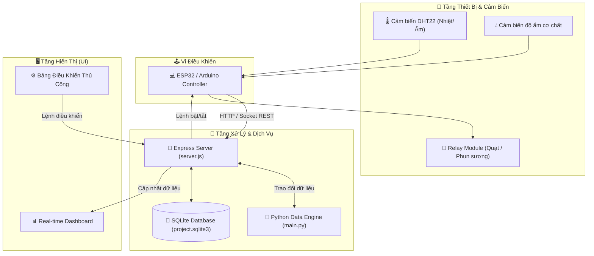

<div align="center">

# 🍄 FUNGI AIOT MANAGEMENT 🍄
### 🌐 Smart Mushroom Farm Automated Climate & Harvest System
*Hệ thống Trí tuệ Nhân tạo Vạn vật (AIoT) Giám sát Môi trường & Quản trị Nông trại Nấm Thông minh*

[](https://nodejs.org/)
[](https://python.org)
[](https://expressjs.com/)
[](https://www.sqlite.org/)
[](https://espressif.com/)

---

</div>

> [!IMPORTANT]
> **Fungi AIoT Management** là giải pháp tự động hoá nông nghiệp công nghệ cao, kết hợp mạng cảm biến IoT và thuật toán phân tích dữ liệu Python nhằm giám sát vi khí hậu nhà nấm, tự động kích hoạt hệ thống phun sương / thông gió và tối ưu hoá chu kỳ thu hoạch.

---

## 📑 Mục Lục (Table of Contents)
- [✨ Tính Năng Nổi Bật](#-tính-năng-nổi-bật)
- [🏗️ Kiến Trúc Hệ Thống](#️-kiến-trúc-hệ-thống)
- [📂 Cấu Trúc Dự Án](#-cấu-trúc-dự-án)
- [⚙️ Công Nghệ Sử Dụng](#️-công-nghệ-sử-dụng)
- [🚀 Hướng Dẫn Cài Đặt & Chạy Dự Án](#-hướng-dẫn-cài-đặt--chạy-dự-án)
  - [1. Yêu cầu hệ thống](#1-yêu-cầu-hệ-thống)
  - [2. Cài đặt môi trường & Gói phụ thuộc](#2-cài-đặt-môi-trường--gói-phụ-thuộc)
  - [3. Cấu hình biến môi trường](#3-cấu-hình-biến-môi-trường)
  - [4. Khởi chạy hệ thống](#4-khởi-chạy-hệ-thống)
- [🔮 Lộ Trình Phát Triển (Roadmap)](#-lộ-trình-phát-triển-roadmap)
- [📜 Giấy Phép (License)](#-giấy-phép-license)

---

## ✨ Tính Năng Nổi Bật

| Biểu Tượng | Tính Năng | Mô Tả Chi Tiết |
| :---: | :--- | :--- |
| 🌡️ | **Giám Sát Vi Khí Hậu Thời Gian Thực** | Đo đạc liên tục nhiệt độ không khí, độ ẩm môi trường và độ ẩm phôi nấm thông qua cảm biến DHT / độ ẩm đất. |
| ⚡ | **Tự Động Kích Hoạt Thiết Bị (Actuator)** | Tự động bật/tắt quạt thông gió, máy phun sương siêu âm và đèn chiếu xạ dựa theo ngưỡng ngưỡng tối ưu. |
| 📊 | **Trực Quan Hóa Dữ Liệu Dashboard** | Giao diện đồ thị thời gian thực theo dõi biến thiên nhiệt ẩm theo từng mốc thời gian trong ngày. |
| 🗄️ | **Lưu Trữ Chu Kỳ Sinh Trưởng** | Ghi nhận toàn bộ thông số lịch sử vào cơ sở dữ liệu SQLite3 phục vụ đánh giá và cải thiện năng suất. |
| 🔔 | **Cảnh Báo Vượt Ngưỡng An Toàn** | Phát cảnh báo tức thời khi nhiệt độ tăng cao hoặc độ ẩm giảm xuống mức nguy hiểm cho phôi nấm. |

---

## 🏗️ Kiến Trúc Hệ Thống



---

## 📂 Cấu Trúc Dự Án

```bash
fungi-aiot-management/
├── 📄 config.env           # Cấu hình cổng port, biến môi trường và thiết lập kết nối
├── 📄 package.json         # Danh mục thư viện phụ thuộc Node.js
├── 📄 requirements.txt     # Danh mục thư viện Python (numpy, pandas, analytics)
├── 📄 project.sqlite3      # Cơ sở dữ liệu SQLite lưu trữ dữ liệu cảm biến
├── 📄 server.js            # Server chính tiếp nhận dữ liệu và phục vụ API
├── 📄 main.py              # Xử lý tính toán, phân tích và logic thuật toán
├── 📂 js/                  # Mã nguồn JavaScript phía client xử lý biểu đồ và tương tác
├── 📂 python/              # Các kịch bản phụ trợ kết nối và xử lý dữ liệu
└── 📄 README.md            # Tài liệu hướng dẫn dự án
```

---

## ⚙️ Công Nghệ Sử Dụng

- **Backend Platform**: Node.js, Express.js
- **Data Analytics Engine**: Python 3, SQLite Driver
- **Database**: SQLite3 (`project.sqlite3`)
- **Frontend Dashboard**: HTML5, Modern CSS3, Chart.js / Vanilla JS
- **Hardware Integration**: ESP32 / ESP8266, DHT22 Sensor, 4-Channel 5V Relay

---

## 🚀 Hướng Dẫn Cài Đặt & Chạy Dự Án

### 1. Yêu cầu hệ thống
- **Node.js** `>= 16.x`
- **Python** `>= 3.8`
- Phần cứng (tuỳ chọn): Mạch ESP32/ESP8266 đã nạp firmware truyền dữ liệu qua HTTP hoặc Serial.

### 2. Cài đặt môi trường & Gói phụ thuộc

```bash
# Clone dự án
git clone https://github.com/baolam/fungi-aiot-management.git
cd fungi-aiot-management

# Cài đặt thư viện Node.js
npm install

# Cài đặt thư viện Python
pip install -r requirements.txt
```

### 3. Cấu hình biến môi trường
Tùy chỉnh thông số trong file `config.env` (Port, Database path, thresholds nhiệt/ẩm).

### 4. Khởi chạy hệ thống

```bash
# 1. Khởi chạy Web Server Node.js
node server.js

# 2. Khởi chạy module phân tích dữ liệu Python (ở terminal riêng)
python main.py
```
> 🌐 Mở trình duyệt và truy cập: `http://localhost:3000`

---

## 🔮 Lộ Trình Phát Triển (Roadmap)

- [ ] 🤖 **Computer Vision Disease Detection**: Tích hợp camera chụp phôi nấm và mô hình YOLO nhận diện nấm mốc / mầm bệnh sớm.
- [ ] 📱 **Mobile App Control**: Ứng dụng di động Flutter nhận cảnh báo khẩn qua push notification.
- [ ] ☁️ **Cloud Telemetry**: Đồng bộ dữ liệu vi khí hậu lên MQTT Broker / AWS IoT Core.

---

<div align="center">

## 📜 Giấy Phép (License)

Dự án được phân phối dưới giấy phép mã nguồn mở **MIT License**.

---
**Made with ❤️ by [Bảo Lâm](https://github.com/baolam)**

</div>
